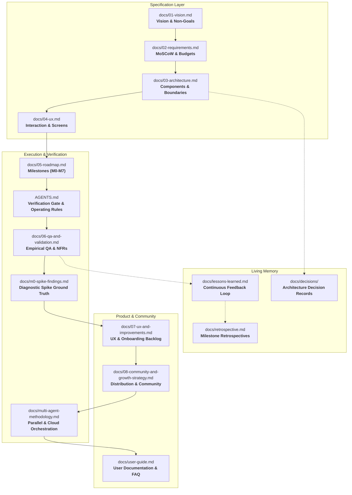
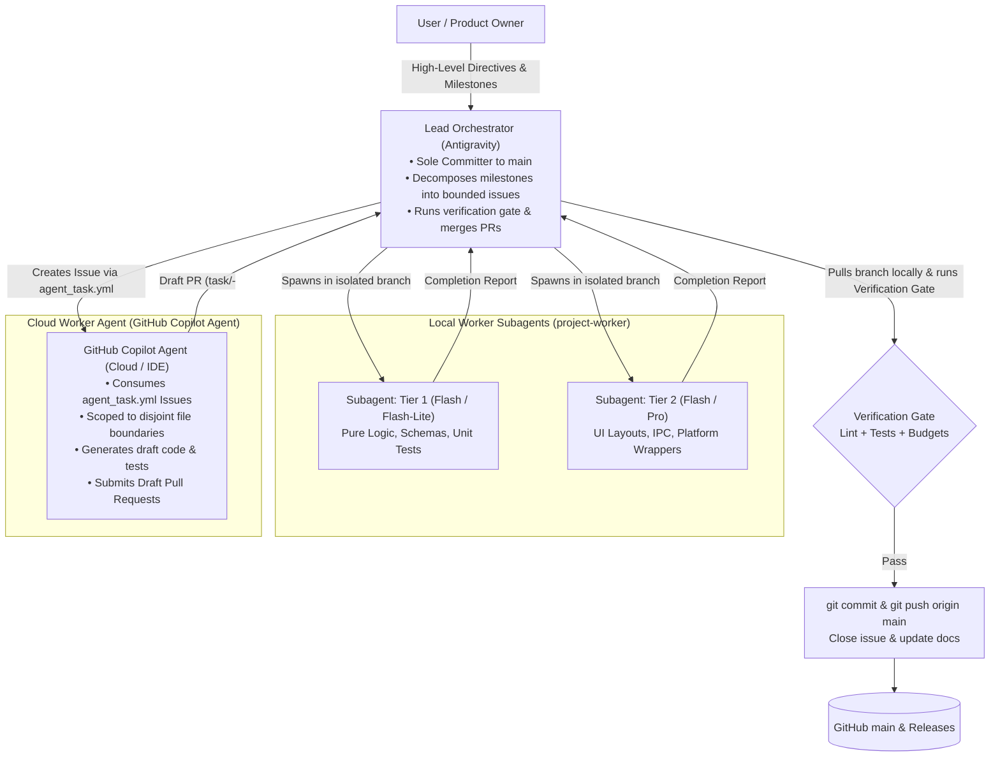

# 🚀 Project Template

[](docs/README.md)
[](AGENTS.md)
[](docs/multi-agent-methodology.md)
[](.github/workflows/ci.yml)
[](AGENTS.md#6-task-lifecycle)
[](LICENSE)

A battle-tested, **spec-first**, **agent-ready** project template engineered for high-velocity software development with autonomous AI coding agents (Antigravity, GitHub Copilot) and human engineers. Bootstrapped with the **Project Kickstart** methodology.

---

## 🌟 Why This Template?

Modern AI coding agents are exceptionally fast at writing code, but they frequently encounter systemic failure modes in real-world repositories:
- **Context Drift:** Agents lose track of architecture decisions made 3 conversations ago.
- **Hallucinated Constraints:** Guessing unverified external APIs or hardware capabilities.
- **Chaos in Git History:** Uncontrolled parallel commits, broken main branches, and untracked rollbacks.
- **Siloed Knowledge:** Corrections and lessons learned in one chat session evaporate in the next.

This template eliminates these bottlenecks by embedding **operational constraints, architectural boundaries, automated CI/CD gates, and continuous learning directly into the repository files**.

---

## 🏛️ Core Architectural Pillars

### 1. The Complete Spec Stack (`docs/`)
All knowledge lives in version-controlled markdown specifications before any application code is written.



Detailed guides for each document are available in the [Documentation Guide](docs/README.md).

---

### 2. Dual-Agent Parallel Architecture: Antigravity + GitHub Copilot
This template pioneers a hybrid **Hub-and-Spoke** division of labor combining local interactive reasoning with asynchronous cloud agent execution:



- **Antigravity (Local Lead Agent):** Acts as the Lead Architect and **Sole Committer**. It analyzes dependencies, defines self-contained issues using [`.github/ISSUE_TEMPLATE/agent_task.yml`](.github/ISSUE_TEMPLATE/agent_task.yml), verifies incoming pull requests locally, and updates documentation.
- **GitHub Copilot Agent (Cloud Worker):** Acts as the **Fast Draft Implementer**. It consumes GitHub Issues in the cloud or IDE, adheres to [`.github/copilot-instructions.md`](.github/copilot-instructions.md), writes unit tests, and submits **Draft Pull Requests**. It is strictly forbidden from committing directly to `main`.
- Read the full [Multi-Agent Methodology Guide](docs/multi-agent-methodology.md) for sequence diagrams and protocol details.

---

### 3. Complexity Tiers & Model Routing
Tasks are categorized by complexity to optimize both execution speed and cognitive capability:

| Tier | Scope | Recommended Model |
|---|---|---|
| **T1 Lean** | Pure deterministic logic, data schemas, unit tests, i18n, build scripts, docs | Fast / Lightweight models (e.g., Flash, Haiku) |
| **T2 Moderate** | UI layouts, standard IPC, platform integrations, standard REST/gRPC endpoints | Balanced models (e.g., Sonnet, Pro) |
| **T3 Critical** | Concurrency, safety-critical routines, crypto, custom hardware/kernel hooks, performance hot paths | High-reasoning models (e.g., Pro, Opus) |

*Any model downgrade due to quota or rate-limiting is logged in [`docs/model-fallback-log.md`](docs/model-fallback-log.md) for mandatory audit before release.*

---

### 4. Claims Follow Evidence
- **No Guesswork:** Never present unverified assumptions (hardware behaviors, external APIs, network latency) as fact.
- **Spikes (🔬):** Unverified technical points are isolated as Milestone 0 spikes and documented with real outputs in [`docs/m0-spike-findings.md`](docs/m0-spike-findings.md).
- **Decoupled QA:** Headless automated mock/invariant tests run on every commit; manual, UI, or hardware testing stays marked **`Pending`** in [`docs/06-qa-and-validation.md`](docs/06-qa-and-validation.md) until empirically confirmed by the user. Community testers report results via [`.github/ISSUE_TEMPLATE/qa_verification.yml`](.github/ISSUE_TEMPLATE/qa_verification.yml).

---

### 5. Continuous Learning & Retrospectives
- **Living Lessons Learned:** When an agent receives a correction or encounters friction, it documents the root cause and creates an actionable rule in [`docs/lessons-learned.md`](docs/lessons-learned.md).
- **Repository Operating Rules:** Universal rules are promoted to [`AGENTS.md`](AGENTS.md) and [`.github/copilot-instructions.md`](.github/copilot-instructions.md).
- **Milestone Retrospectives:** Finished milestones undergo structured retrospectives in [`docs/retrospective.md`](docs/retrospective.md) analyzing failure modes, velocity, and multi-agent token economics.

---

## 📦 Automated Release & Multi-Channel Distribution

The repository includes pre-configured automation scripts in `scripts/`:
- **Portable Packaging (`scripts/package-release.ps1`):** Builds release binaries, stages documentation and assets, creates `.zip` archives, and computes SHA-256 checksums.
- **Package Manager Manifests (`scripts/generate-manifests.ps1`):** Automatically produces Windows Package Manager (**WinGet**) and **Scoop** manifests.
- **Zero-Elevation Installers (`scripts/setup-wizard.ps1`, `scripts/install.ps1`, `scripts/uninstall.ps1`, `setup.cmd`):** Clean graphical and console installers into `%LOCALAPPDATA%\Programs\<ProjectName>`.
- **Inno Setup Script (`scripts/installer.iss`):** Ready-to-compile native Windows installer script.
- **GitHub Actions CI/CD (`.github/workflows/`):** Automated PR/push verification in `ci.yml` and tag-triggered GitHub Releases in `release.yml`.

---

## 📂 Repository Tour

```text
├── .github/
│   ├── ISSUE_TEMPLATE/
│   │   ├── agent_task.yml          # Form template for delegating tasks to Copilot / subagents
│   │   ├── agent_task.md           # Markdown template fallback for agent task issues
│   │   ├── bug_report.yml          # Structured bug report with QA test IDs
│   │   ├── feature_request.yml     # Feature requests tied to MoSCoW priorities
│   │   └── qa_verification.yml     # Empirical manual / hardware QA verification report
│   ├── workflows/
│   │   ├── ci.yml                  # Automated PR & push verification gate
│   │   └── release.yml             # Tag-triggered GitHub Releases and asset publishing
│   ├── copilot-instructions.md     # Binding instructions for GitHub Copilot (Agent & IDE)
│   └── pull_request_template.md    # PR template enforcing verification gate checks & Draft PR rules
├── docs/
│   ├── decisions/
│   │   └── 0000-template.md        # Architecture Decision Record (ADR) skeleton
│   ├── 01-vision.md                # Vision, problem statement, principles, non-goals
│   ├── 02-requirements.md          # MoSCoW functional requirements & NFR budgets
│   ├── 03-architecture.md          # Component diagrams, tech stack, disjoint modules
│   ├── 04-ux.md                    # Interaction flows, screens, and accessibility
│   ├── 05-roadmap.md               # Sized milestone task board with parallel markers (⇉)
│   ├── 06-qa-and-validation.md     # Empirical validation matrix & budget measurements
│   ├── 07-ux-and-improvements.md   # UX backlog, setup wizard, responsive refactor
│   ├── 08-community-and-growth-strategy.md # WinGet, Scoop, and community expansion strategy
│   ├── m0-spike-findings.md        # Ground truth from Milestone 0 diagnostic spikes
│   ├── multi-agent-methodology.md  # Detailed Antigravity + Copilot collaboration guide
│   ├── user-guide.md               # End-user documentation and troubleshooting FAQ
│   ├── lessons-learned.md          # Living log of friction points and rules adopted
│   ├── model-fallback-log.md       # Audit trail for downgraded agent runs
│   ├── release-methodology.md      # SemVer, version source of truth, and release checklist
│   ├── retrospective.md            # Milestone retrospective and token economics template
│   └── README.md                   # Comprehensive guide to the documentation system
├── scripts/
│   ├── generate-manifests.ps1      # WinGet & Scoop manifest generator
│   ├── install.ps1                 # Zero-elevation user-level installer
│   ├── installer.iss               # Inno Setup native Windows installer template
│   ├── package-release.ps1         # Automated release bundler & SHA-256 calculator
│   ├── setup-wizard.ps1            # Graphical & console guided Windows setup wizard
│   └── uninstall.ps1               # Clean application and shortcut uninstaller
├── setup.cmd                       # Double-clickable Windows setup launcher
├── AGENTS.md                       # Binding operational rules and verification gate
├── CHANGELOG.md                    # Chronological milestone changelog
├── CONTRIBUTING.md                 # Contribution, branching, and multi-agent pair programming guide
├── LICENSE                         # MIT License
├── SECURITY.md                     # Security policy, memory/platform guarantees, vulnerability reporting
├── SUPPORT.md                      # Community support channels, quick docs links, FAQ
└── README.md                       # Repository overview and onboarding
```

---

## 🚦 Getting Started

### Method A: Using as a GitHub Template (Recommended)
1. Click **"Use this template"** > **"Create a new repository"** on GitHub.
2. Clone your new repository locally:
   ```bash
   git clone https://github.com/<your-username>/<your-repo-name>.git
   cd <your-repo-name>
   ```
3. Open the repository in your favorite AI-enabled environment (Antigravity, Cursor, VS Code, etc.).
4. Run the Project Kickstart discovery flow:
   - In Antigravity: Run the `/project-kickstart` skill or prompt:
     > *"Initialize project definition using the templates in this repository."*
   - In other assistants: Prompt the agent to interview you following the sections in `docs/01-vision.md` through `05-roadmap.md`.
5. Review and approve the generated specifications.
6. Begin implementing Milestone 0 (Spikes) and Milestone 1 (Skeleton)!

### Method B: Manual Configuration
1. Fill in [`AGENTS.md`](AGENTS.md) with your project mission, critical complexity areas, verification gate commands, and hard rules.
2. Replace the `{{...}}` placeholders in `docs/01-vision.md` through `docs/05-roadmap.md`.
3. Set up your verification gate command in [`AGENTS.md`](AGENTS.md#6-task-lifecycle) (e.g., `cargo test`, `npm test`, `pytest`).
4. Commit your initial project specification.

---

## 🔄 The Milestone Lifecycle

Every project built with this template progresses through 8 structured milestones:

```text
M0: Spikes (🔬)           De-risk unknowns with disposable diagnostic probes; record in m0-spike-findings.md.
M1: Skeleton              Establish module structure, CI pipeline, and verification gate.
M2: Core Logic            Implement deterministic domain logic (100% unit-tested).
M3: Integrations          Connect OS APIs, persistence, networking, and external services.
M4: User Interface        Build UI views, entry points, and state management.
M5: Hardening & QA        Measure NFR budgets, conduct edge-case, soak, and crowdsourced QA testing.
M6: Packaging & Release   Build binaries/artifacts with scripts/, publish GitHub Releases & package manifests.
M7: Retrospective         Review lessons learned in retrospective.md and promote generic rules to toolkits.
```

---

## 🛡️ Operating Rules for AI Agents

All AI assistants working on this repository must read and adhere to [`AGENTS.md`](AGENTS.md):
1. **Always read documents in mandatory order:** Vision -> Requirements -> Architecture -> UX -> Roadmap -> QA -> Spikes -> UX Backlog -> Community -> Methodology -> Decisions -> Lessons Learned.
2. **Work on one roadmap task at a time:** Check off items in [`docs/05-roadmap.md`](docs/05-roadmap.md) with date and commit hash only after passing the verification gate.
3. **Run the Verification Gate:** Every change must satisfy the verification gate commands before being considered complete.
4. **Environment Resiliency:** Never assume standard toolchains are in `$PATH`; explicitly configure environment variables.
5. **Cross-Platform Hygiene:** Use UTF-8 encoding without BOM, avoid unconstrained recursive file searches over dependency caches (`node_modules`, `target`, `.venv`), and do not commit build artifacts.

---

## 📄 License

This template is licensed under the [MIT License](LICENSE). Feel free to use, adapt, and distribute it for personal and commercial projects.
