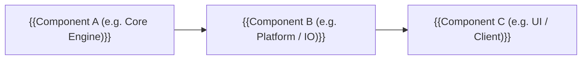

# 03 — Architecture

> Status: **DRAFT**. 🔬 = must be confirmed by a Milestone 0 spike.

## Tech stack (see `decisions/0001-*.md`)
| Concern | Choice |
|---|---|
| Language / runtime | {{e.g. Rust 2024 stable / TypeScript Node 20 / Go 1.23}} |
| UI Framework | {{e.g. egui / iced / Slint / React 19 Next.js / Tailwind}} |
| Data & Storage | {{e.g. TOML config / SQLite + Prisma / embedded RocksDB}} |
| i18n & Localization | {{e.g. Fluent / TOML locales / next-intl}} |
| Packaging & Distribution | {{e.g. Inno Setup + WinGet + Scoop + Portable ZIP}} |
| Build & CI | {{e.g. GitHub Actions (Windows x64 / Linux)}} |

---

## Component / Process Model


---

## Module Boundaries (Designed for Parallel Worker Execution)

### Pattern A: Native Systems / Desktop Architecture
```text
crates/ (or packages/)
├── core/          # Pure deterministic business logic, #![forbid(unsafe_code)], 0 Win32/IO deps, 100% unit-tested
├── platform/      # OS integration, low-level hooks, named pipe IPC, device discovery
├── ui/            # Native GUI (e.g., eframe/egui, Slint, iced), zero business logic
└── probe/         # Disposable M0 diagnostic CLI utility for hardware/API spikes
```

### Pattern B: Fullstack / Web SaaS Architecture
```text
src/
├── lib/
│   ├── calculations/  # Pure business & financial calculation engine, 100% unit-tested (zero DB/UI deps)
│   └── db/            # Database client & ORM models (Prisma / Drizzle / SQLite / PostgreSQL)
├── components/
│   ├── tabs/          # Decomposed tab views (Dashboard, Inventory, Vault, Settings)
│   └── modals/        # Isolated CRUD dialogues & workflows
└── app/
    ├── api/           # Headless REST / RPC route handlers with payload validation
    └── page.tsx       # Lightweight coordinator synchronizing active tab via URL search params (?tab=...)
```

> **Parallelism Rule:** Independent roadmap tasks must touch disjoint modules or files. Cross-module dependencies communicate via stable, frozen contracts or interfaces.

---

## Key Technical Designs

### {{Design 1, e.g. Core Logic Isolation & Safety}}
{{Mechanism, constraints, why}}

### {{Design 2, e.g. Single-Binary Unification & Setup Ergonomics}}
{{How background daemon and GUI or CLI tools are unified into a single executable or clean installer}}

### {{Design 3}} 🔬
{{Unknowns and the planned fallback, tested via Milestone 0 spike}}

---

## Rejected Alternatives
- {{Option A}}: rejected because {{reason, e.g. memory overhead, admin rights requirement}}.
- {{Option B}}: rejected because {{reason, e.g. architectural complexity}}.

---

## Known Limitations
- {{e.g. OS restriction, display scaling quirk, or hardware limitation}}
